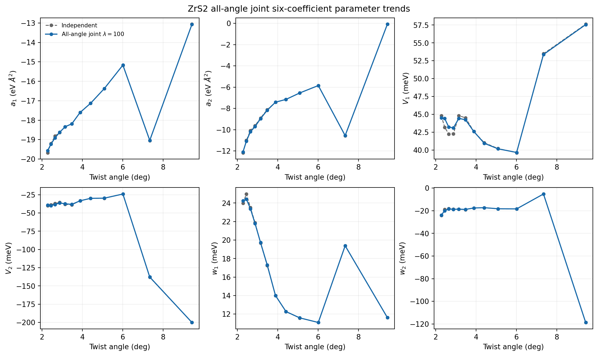
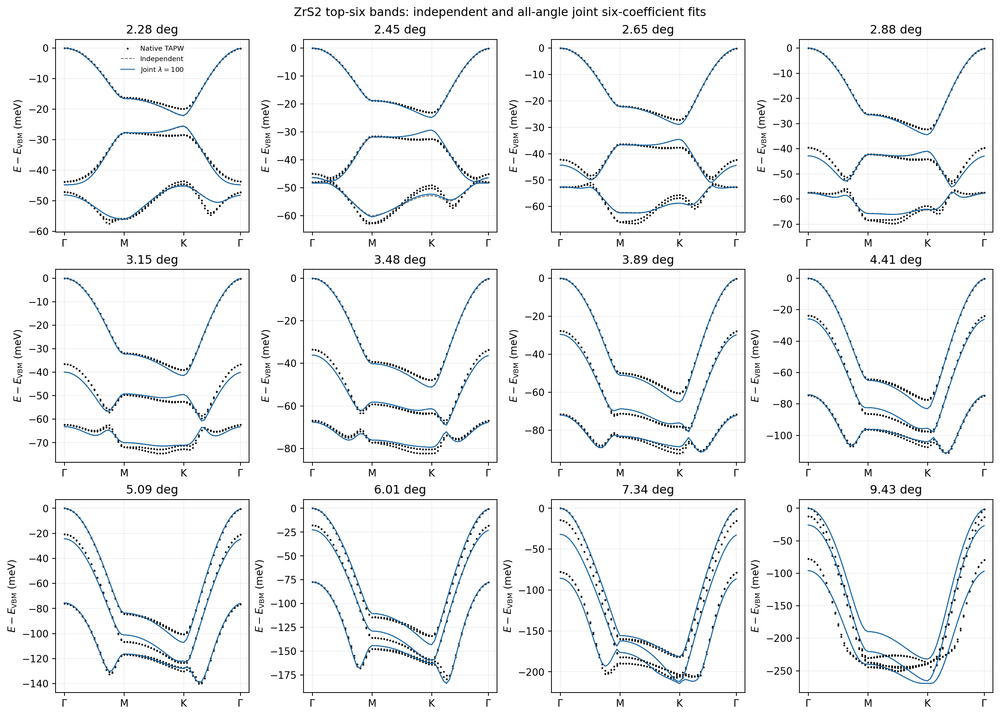
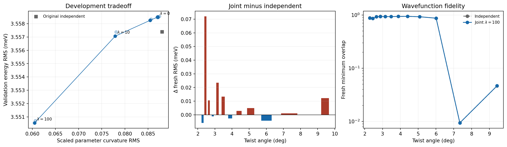

# ZrS2 all-angle joint six-coefficient fit

Scope: all 12 available angles from 2.28 to 9.43 degrees. Every angle retains exactly six real Hamiltonian coefficients.

## Outcome

The development-selected fit is `lambda_100_previous`. Scaled parameter curvature decreases by 31.3%, from 0.0880 to 0.0605.

| Metric | Independent | All-angle joint |
|---|---:|---:|
| Validation energy RMS (meV) | 3.5574 | 3.5505 |
| Validation direct-gap RMS (meV) | 3.5453 | 3.5150 |
| Validation minimum-overlap mean | 0.7470 | 0.7483 |
| Full-path RMS mean (meV) | 3.6347 | 3.6292 |
| Fresh TAPW RMS mean (meV) | 3.5961 | 3.6067 |
| Fresh minimum overlap | 0.009434 | 0.009404 |

The all-angle fit smooths the coefficient curves and marginally improves development/full-path averages. It slightly worsens the untouched fresh TAPW RMS and does not repair the 7.34 or 9.43 degree wavefunction failure. It must not replace the production small-angle models.

## Fresh-point breakdown

| Angle | Independent RMS | Joint RMS | Independent min overlap | Joint min overlap |
|---:|---:|---:|---:|---:|
| 2.28 | 0.9768 | 0.9709 | 0.878930 | 0.877649 |
| 2.45 | 0.7435 | 0.8155 | 0.860761 | 0.858763 |
| 2.65 | 1.0013 | 1.0119 | 0.925281 | 0.923367 |
| 2.88 | 1.5066 | 1.5056 | 0.938171 | 0.936481 |
| 3.15 | 1.5319 | 1.5554 | 0.930533 | 0.932203 |
| 3.48 | 1.3803 | 1.3936 | 0.931385 | 0.932276 |
| 3.89 | 1.5366 | 1.5340 | 0.937748 | 0.937712 |
| 4.41 | 1.9424 | 1.9452 | 0.941531 | 0.941363 |
| 5.09 | 2.5224 | 2.5273 | 0.925649 | 0.925505 |
| 6.01 | 3.8668 | 3.8625 | 0.869609 | 0.869683 |
| 7.34 | 7.2872 | 7.2884 | 0.009434 | 0.009404 |
| 9.43 | 18.8576 | 18.8698 | 0.046587 | 0.046701 |

## Verification

- Analytic Jacobian passed three directional finite-difference checks at relative errors below 2.5e-8.
- All 12 exported NPZ files contain exactly six parameters.
- Q vectors, Fourier basis, and coordinate transforms are unchanged.
- Hermiticity and independent path/fresh-point recomputation passed.
- Fresh native points were excluded from development selection.

## Figures

