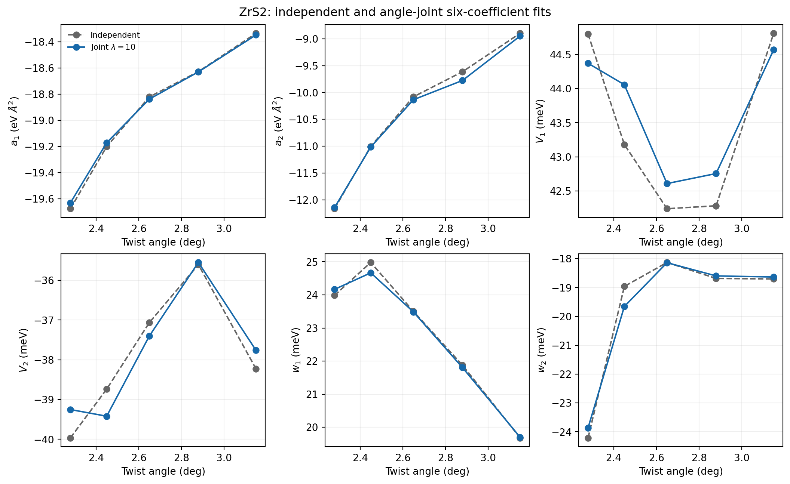
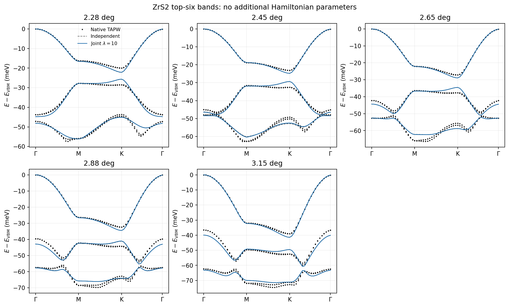
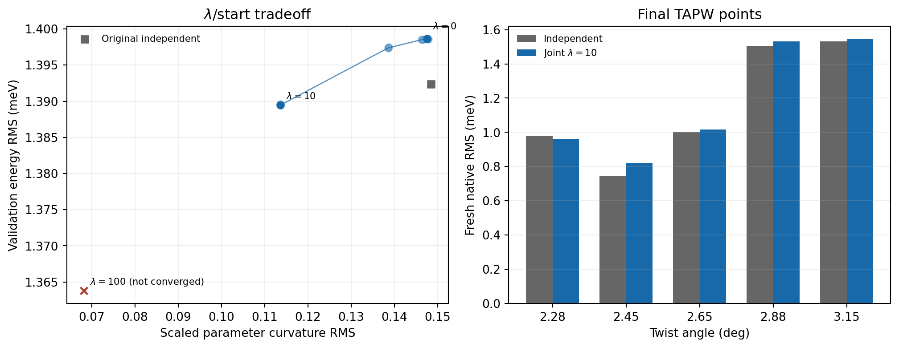

# ZrS2 small-angle joint six-coefficient fit

Scope: AB ZrS2 at 2.28, 2.45, 2.65, 2.88, and 3.15 degrees.
The Hamiltonian family is unchanged: six independent real coefficients per angle and no additional Fourier or momentum terms.

## Result

The development-selected diagnostic is `lambda_10_quadratic`. It reduces scaled parameter curvature by 23.5%, from 0.1485 to 0.1136.

| Metric | Independent | Joint lambda=10 |
|---|---:|---:|
| Validation energy RMS (meV) | 1.3924 | 1.3895 |
| Validation direct-gap RMS (meV) | 2.1814 | 2.1171 |
| Mean validation minimum overlap | 0.8366 | 0.8391 |
| Full-path RMS mean (meV) | 1.4246 | 1.4232 |
| Fresh TAPW RMS mean (meV) | 1.1520 | 1.1750 |
| Fresh minimum overlap | 0.8608 | 0.8589 |

The joint fit is smoother and marginally improves development/full-path metrics, but it slightly worsens the untouched fresh TAPW energy RMS and minimum overlap. It is therefore retained as a diagnostic and does not replace the independent production models.

## Parameters

| Angle | Mode | a1 | a2 | V1 (meV) | V2 (meV) | w1 (meV) | w2 (meV) |
|---:|---|---:|---:|---:|---:|---:|---:|
| 2.28 | Independent | -19.675060 | -12.163164 | 44.7978 | -39.9632 | 23.9837 | -24.2088 |
| 2.28 | Joint | -19.630783 | -12.142566 | 44.3698 | -39.2510 | 24.1656 | -23.8610 |
| 2.45 | Independent | -19.200488 | -11.002849 | 43.1812 | -38.7387 | 24.9789 | -18.9615 |
| 2.45 | Joint | -19.171224 | -11.013738 | 44.0564 | -39.4186 | 24.6654 | -19.6567 |
| 2.65 | Independent | -18.820878 | -10.080506 | 42.2413 | -37.0623 | 23.5010 | -18.1305 |
| 2.65 | Joint | -18.837981 | -10.134859 | 42.6095 | -37.4006 | 23.4848 | -18.1388 |
| 2.88 | Independent | -18.627798 | -9.613849 | 42.2841 | -35.6040 | 21.8752 | -18.6845 |
| 2.88 | Joint | -18.629896 | -9.776657 | 42.7559 | -35.5493 | 21.8041 | -18.5967 |
| 3.15 | Independent | -18.335291 | -8.899215 | 44.8088 | -38.2259 | 19.6815 | -18.7026 |
| 3.15 | Joint | -18.347743 | -8.950027 | 44.5675 | -37.7608 | 19.7015 | -18.6351 |

## Verification

- Analytic joint Jacobian passed three directional finite-difference checks at relative errors around 1e-8.
- Every exported archive has exactly six parameters.
- Q vectors, first Fourier vector, and coordinate transform are unchanged.
- Hermiticity and independent full-path/fresh-point recomputation passed.
- The 12 fresh native points per angle were excluded from model selection.
- The hard indirect gap is reported for validation; a fixed 0.25 meV soft-extrema temperature was used only inside the differentiable fit loss.

## Figures

